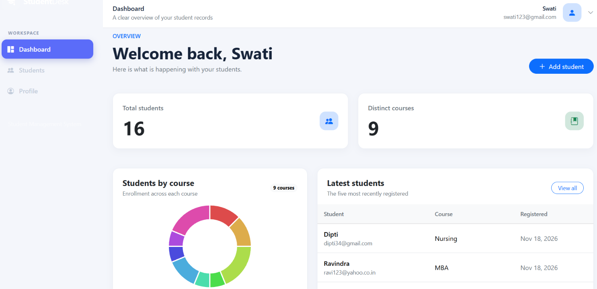
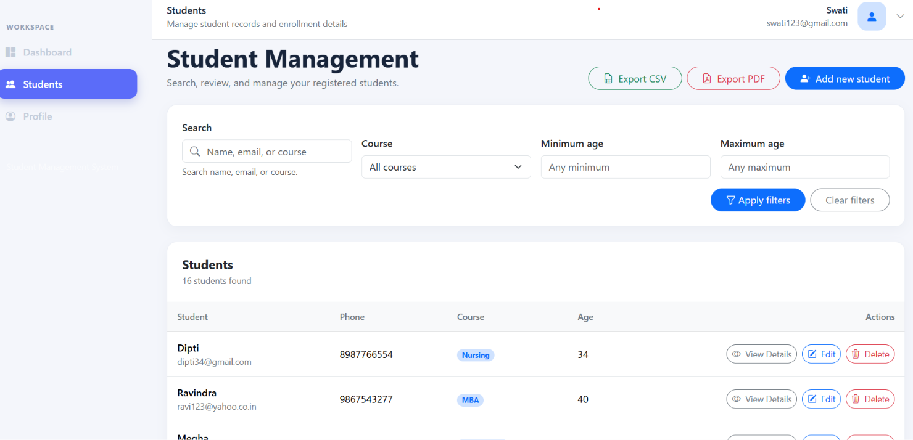
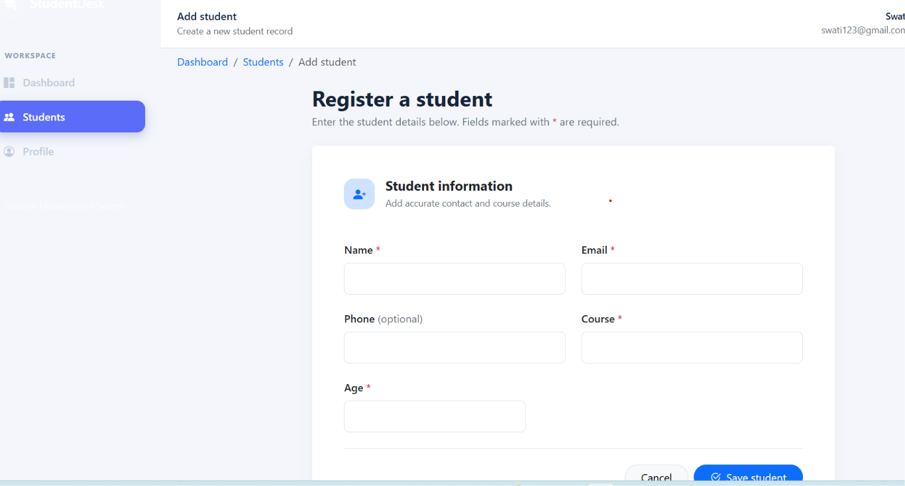
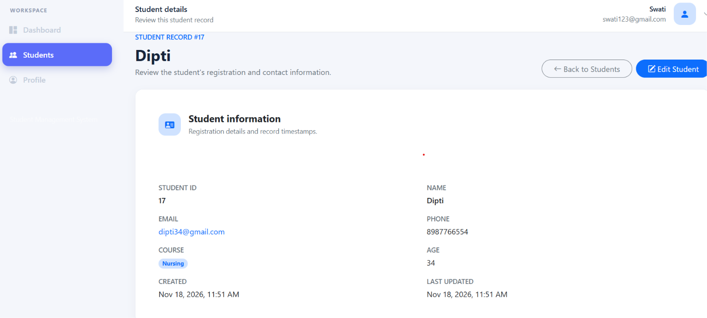

# Student Management System

A Laravel 12 web application for managing student records. Administrators can sign in to manage students, review dashboard statistics, filter and export records, and manage their profile.

## Features

- Admin login, logout, forgot-password and password-reset flows.
- Admin profile and password management.
- Student create, view, edit and delete operations.
- Student search by name, email or course, plus course and age filters.
- Pagination that retains active filters.
- Dashboard statistics, course-wise student counts, recent registrations and a responsive course distribution chart.
- CSV export (`students.csv`) and PDF export (`students.pdf`); exports follow the active filters and include all matching records, regardless of the current page.
- Form validation and automated feature tests.

## Application Screenshots

### Admin Dashboard



### Student Listing



### Add Student



### Student Details



## Technology

- PHP 8.2 or later
- Laravel 12
- MySQL (for the setup below)
- Laravel Blade, Bootstrap 5 and Bootstrap Icons
- Chart.js for the dashboard chart (loaded from a CDN)
- `barryvdh/laravel-dompdf` for PDF downloads
- PHPUnit for automated tests

## Requirements

- PHP 8.2+, Composer, and the PHP extensions required by Laravel 12 and the installed Composer packages.
- MySQL. XAMPP is suitable for local Windows development.
- Internet access when loading the Bootstrap, Bootstrap Icons and Chart.js CDN assets.

Node.js/npm is not required for the current application pages, which load their UI assets from CDNs.

## Windows and XAMPP setup

### 1. Get the project

To clone a published repository, open PowerShell and replace the placeholder with its repository URL:

```powershell
git clone <your-repository-url> student-management
cd student-management
```

Alternatively, download the repository as a ZIP, extract it, and open PowerShell in the extracted project folder.

### 2. Install PHP dependencies

```powershell
composer install
```

### 3. Create your local environment file

If this is a fresh checkout without a `.env` file, run:

```powershell
Copy-Item .env.example .env
```

Open `.env` in a text editor. Set the database connection to MySQL and configure the database you created, for example in phpMyAdmin after starting MySQL in the XAMPP Control Panel:

```dotenv
DB_CONNECTION=mysql
DB_HOST=127.0.0.1
DB_PORT=3306
DB_DATABASE=student_management
DB_USERNAME=root
DB_PASSWORD=
```

The values above match a common local XAMPP setup. Change the username and password if your MySQL installation uses different credentials. Create the `student_management` database before migrating.

### 4. Configure the development admin

The `AdminSeeder` reads these three settings from `.env`:

```dotenv
ADMIN_NAME="Development Admin"
ADMIN_EMAIL=admin@example.com
ADMIN_PASSWORD=replace-with-a-private-local-password
```

Choose your own local admin name, email and password. `ADMIN_PASSWORD` must be set before seeding; the seeder reports an error if required admin details are missing and stores the password as a hash. Keep these values in your ignored local `.env` file. Do not put a real password in this README or in source control.

### 5. Generate the app key, create tables and seed the admin

```powershell
php artisan key:generate
php artisan migrate
php artisan db:seed --class=AdminSeeder
```

The migration command creates the application's tables in the configured database. The seeder command creates or updates the development admin using the three environment values above.

### 6. Start Laravel and sign in

```powershell
php artisan serve
```

Open [http://127.0.0.1:8000/login](http://127.0.0.1:8000/login). Sign in with the `ADMIN_EMAIL` and `ADMIN_PASSWORD` you configured before running the seeder.

## Tests

Run the PHPUnit suite with:

```powershell
php vendor/bin/phpunit --do-not-cache-result
```

The tests use the project's configured test environment. Use a separate test database configuration if you customize that environment; do not point tests at a database containing data you need to keep.

## Exports and dashboard chart

The Students page can download filtered or unfiltered records as `students.csv` or `students.pdf`. The PDF is rendered by the installed Dompdf package. Exported records follow the active search and filters and are not limited to the current pagination page.

The dashboard chart uses Chart.js from a CDN. An internet connection is needed for the chart library and the Bootstrap assets loaded from CDNs.

## Password reset in local development

With `MAIL_MAILER=log`, Laravel does not send a real email. It writes the password-reset message, including its reset link, to `storage/logs/laravel.log`. Treat that log as sensitive while a reset link is valid, and do not share or commit it. For real email delivery, configure a trusted mail provider in the deployment environment.

## Security and deployment

- Never upload `.env`, database credentials, admin passwords, reset links, or other secrets to GitHub.
- Do not commit a local SQLite database or Laravel log files.
- Before production deployment, set `APP_ENV=production` and `APP_DEBUG=false`, use HTTPS, and configure real mail delivery and production database credentials through the deployment environment.
- Keep application dependencies current and follow Laravel's production deployment guidance for cache and filesystem setup.
